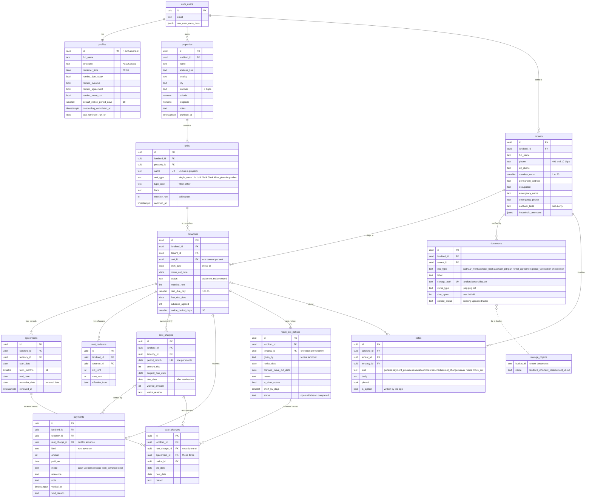
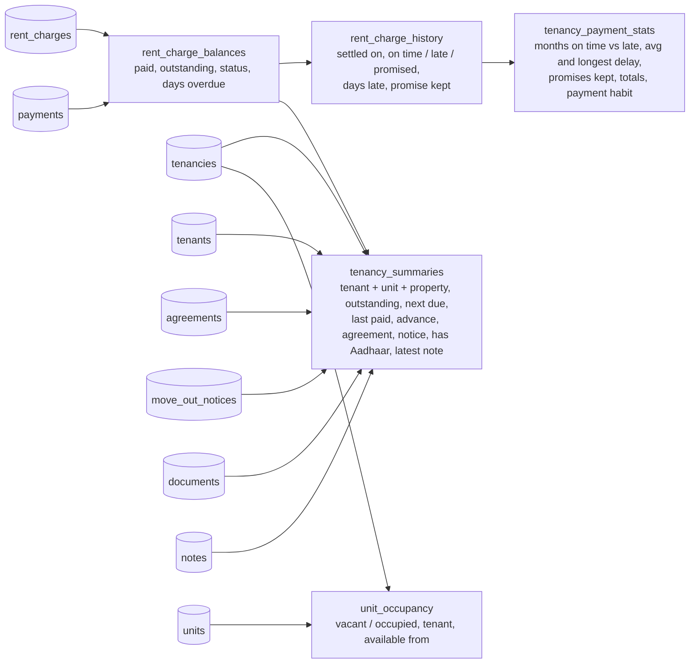

# RMS database

Generated from the migrations in `supabase/migrations/` (13 Nov 2026). The diagrams render on GitHub and in VS Code with a Mermaid preview.

## Entity relationship diagram

Every table except `profiles` also has `landlord_id → auth.users.id`, and Row Level Security only shows a landlord their own rows. To keep the diagram readable, that link is drawn only for `properties` and `tenants`. Child tables reference their parent by `(id, landlord_id)`, so a row can never point at another landlord's data.

All tables also have `created_at`, and all except `rent_revisions` and `date_changes` have `updated_at` (set by a trigger).

## Views (calculated, read-only)

Views use `security_invoker`, so they follow the same Row Level Security as the tables.

## Functions the app calls (`supabase.rpc`)

| Function | Does |
|----------|------|
| `create_property_with_units(property, units)` | Onboarding: a property and all its units; marks onboarding complete |
| `create_tenant(tenant, tenancy, agreement, advance)` | Tenant + tenancy + agreement + advance payment + first rent charges |
| `record_payment(tenancy, amount, …)` | Pays oldest month first; extra kept as advance or error `R0001`; `from_advance` mode |
| `reschedule_rent_charge(charge, new_date, reason)` | Moves one month's due date, keeps history, adds a note |
| `waive_rent_charge(charge, reason)` | Waives what's left of a month |
| `renew_agreement(tenancy, start, term, new_rent, effective_from)` | New agreement period, optional rent change |
| `reschedule_agreement(agreement, new_date, reason)` | Moves the renewal date |
| `record_notice(tenancy, given_by, notice_date, planned_move_out, reason)` | Tenancy goes on notice, flags short notice, drops later months |
| `change_move_out_date(tenancy, new_date, reason)` | Moves the planned move-out date |
| `withdraw_notice(tenancy, reason)` | Tenant stays; tenancy active again |
| `end_tenancy(tenancy, move_out_date, use_advance, waive_remaining, reason)` | Settles with advance, ends tenancy, frees the unit |
| `generate_rent_charges(tenancy?)` | Creates upcoming monthly rent; daily via pg_cron, and on app open |
| `delete_my_account()` | Deletes the signed-in landlord's account; every table cascades. The app deletes their storage files first. |

Helpers used inside them: `landlord_today`, `due_date_in_month`, `format_day`, `add_system_note`, `remove_charges_after`.
